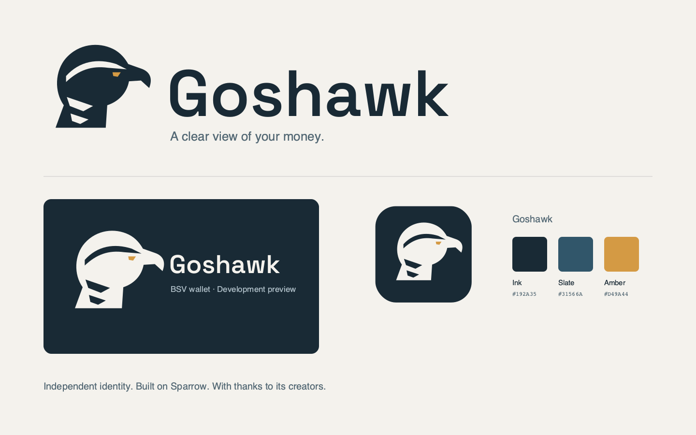

# Goshawk / 苍鹰

The name is the existing English bird name **Goshawk**, paired with **苍鹰**.
Use `Goshawk` in application titles and `Goshawk Wallet` where the category
needs explaining. Do not invent a new bird name or append Vision to the brand.

## Identity

The mark is a goshawk in profile: a rounded crown, strong white eyebrow and
hooked beak, with two open feather cuts. It should feel observant and composed.
Use the silhouette at small sizes; avoid shields, coins, gradients and ornamental
wings. The amber eye is a detail, not an additional financial status signal.

| Role | Colour |
| --- | --- |
| Ink: mark, application tile | `#192A35` |
| Slate: selected controls, focus | `#31566A` |
| Paper: inverse mark, presentation background | `#F4F2ED` |
| Amber: eye and limited brand accents | `#D49A44` |

Space Grotesk Semibold is used for the wordmark, converted to outlines so SVGs
do not depend on installed fonts. The font and OFL license are retained in
`scripts/brand/`. The application keeps its native text font and existing
monospaced transaction typography; native usability takes precedence over
decorative branding. Green, yellow and red transaction/network states retain
their existing meanings.

Use `goshawk-mark.svg` on light surfaces, `goshawk-mark-inverse.svg` on dark
surfaces, and `goshawk-mark-mono.svg` when only one ink is available. Keep at
least 20% of the mark's width clear around it. Do not distort or rotate it.
The app tile is a separate asset, not the general-purpose logo.

## Source and application

- `scripts/brand/render.py`: vector master and repeatable export pipeline.
- `docs/brand/`: outlined lockups, standalone marks and this identity sheet.
- `branding/goshawk/resources/image/`: shipped application and tray icons.
- `branding/goshawk/deploy/`: platform icons and packaging resources.
- `branding/goshawk/brand.gradle`: explicit upstream-resource override policy.

This is a scoped identity layer. Wallet layout and transaction behavior remain
upstream-derived. The About window retains source attribution and links to
Sparrow. Brand graphics are newly authored vectors, not edits of Sparrow's logo.

Rebuild with the commands in `scripts/brand/render.py`; ICNS generation needs
macOS `iconutil`. Existing platform exports are checked in for other systems.

## Native version metadata

Product version: `0.1.0-dev`. The macOS bundler requires a positive first version
component, so its internal build version is `1.0.0`; the custom plist retains
`0.1.0` as the displayed short version. This is development output, not a stable
1.0 release.
