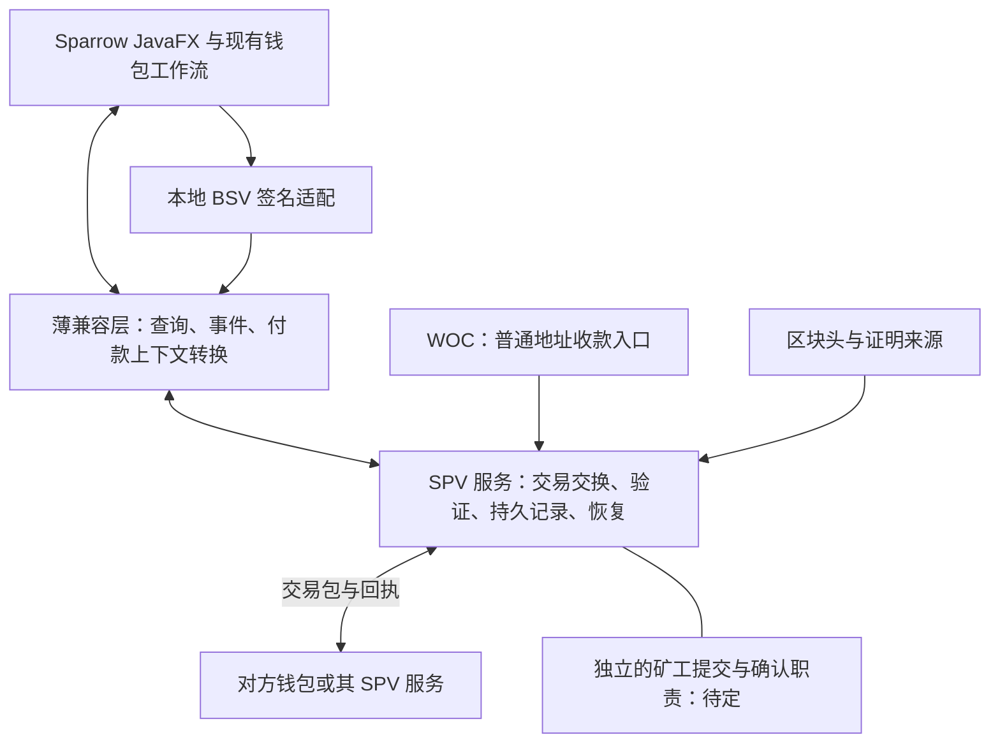

# Goshawk：Java 路线与 BSV 收付款接入

日期：2026-11-16。状态：源码调研与架构草案；尚未实现或验证 BSV 钱包功能。

## 1. 本次已确定的方向

这些事项来自用户在本次讨论中的明确选择：

1. 基于 Sparrow 改造，采用 Java，沿用其桌面界面和工程基础。
2. 第一版定位为专业资金钱包：收发、UTXO 管理、交易检查、备份恢复。
3. 参考 BSV Desktop 的收付款业务与流程，接入 P2P 收付款数据。
4. 普通地址收款通过 WhatsOnChain（WOC）查询与转换来兼容 Sparrow。
5. P2P 收付款与普通地址收款共同服务于钱包自己的交易、输出和历史视图。
6. 改造应集中在一层薄的兼容转换层，尽量保留 Sparrow 的原有代码；底层以 SPV 服务的端到端交易交换为主流程，不以广播交易后等待索引器发现来完成收付款。
7. 对等方接受交易后，允许把接纳结果转换成 Sparrow 所期待的 mempool／未确认交易记录。用户进一步明确：这里的接受应表示入池完成，不是仅收到消息。
8. 收交易的通知与发送同等重要，特别需要解决新收款脚本归属、持久化后通知、重连与重启补收。

Rust 已退出本次实现路线。此前只是候选调研，没有形成 Rust 实现，也没有选定 Rust 依赖。选择 Java 的依据是保留 Sparrow 的桌面工程和交互，而不是假设 BTC 与 BSV 的协议差异已经消失。

本次进一步修订：前稿把 WOC 只读查询作为第一阶段，并把“广播与付款交付”合成一个出口，这不足以表达用户要求。现在优先验证 SPV 交换与 Sparrow 兼容层；WOC 保留为普通地址收款的边缘兼容。WOC 的授权范围没有扩展到所有 P2P 付款，也没有扩展成普通地址付款的自动广播回退。

后续裁定修订：前一稿把 `get_mempool` 限定为独立节点观察，并要求重写发送完成判断，过度收紧了兼容边界。用户允许接纳状态映射，并明确接受回执在入池完成后产生；本地代码也表明 Sparrow 的发送完成检测实际检查 `get_history` 中的目标交易和非正高度。因此撤销“一律禁止 mempool 映射”的建议，改为有来源、可重建的兼容投影。仅收到消息不能提升成入池完成，区块确认仍由有效证明决定。此变更不是运行验证结果。

## 2. 源码基线与证据

工作目录已取得 Sparrow 源码及其 drongo、lark 子模块。这里只建立本地开发分支，没有创建远端 fork、推送或发布。

| 项目 | 本次读取的提交 |
| --- | --- |
| Sparrow | `ddb486dd37ddfa4071e95a81e5c78298433073b6` |
| drongo（Sparrow 指定的子模块） | `4d85e20bad80d8f25a8e422d9d1ed8308f7e01b7` |
| lark（Sparrow 指定的子模块） | `4eaaf9d2ef242164c801ab21247e616e5c4ef8f7` |
| BSV Desktop（远端只读调研） | `f65213f4202de5ef1b48847287bd47111e5ec436` |

Sparrow 使用 Java / JavaFX，并依赖 drongo 的交易与钱包模型、lark 的设备集成。[Sparrow 构建配置](https://github.com/sparrowwallet/sparrow/blob/ddb486dd37ddfa4071e95a81e5c78298433073b6/build.gradle)

BSV Desktop 当前为 Electron / TypeScript。它从 Tauri 迁移的直接原因是复用依赖 Node.js 的 StorageKnex / better-sqlite3，并非 Rust 或 Tauri 不能存储 SQLite 数据。[迁移说明](https://github.com/bsv-blockchain/bsv-desktop/blob/f65213f4202de5ef1b48847287bd47111e5ec436/PORTED.md)

本次以源码和具体流程文档为准。BSV Desktop 的 README 存在历史说明：例如仍写着没有自动测试，但 package.json 已列出多组测试；不能把 README 的所有描述当作当前运行事实。

## 3. BSV Desktop 实际存在的两条收款路径

### P2P 身份付款

当前流程优先尝试直接连接；在尚未创建付款且条件允许时，可退到 Message Box。已经创建的付款需要重试原交易，不能因交付失败再次创建付款。

收款方接收交易数据及派生信息，验证归属并记入钱包。直接收款与 Message Box 收款有去重、重试及持久化状态。对方确认收到、钱包已接纳、广播已接受和链上确认是不同事实。

证据：[付款路由](https://github.com/bsv-blockchain/bsv-desktop/blob/f65213f4202de5ef1b48847287bd47111e5ec436/src/lib/pages/Dashboard/Payments/payFlow.ts)、[直接付款与保留收据](https://github.com/bsv-blockchain/bsv-desktop/blob/f65213f4202de5ef1b48847287bd47111e5ec436/src/lib/pages/Dashboard/Payments/directPayments.ts)、[Message Box 自动接收](https://github.com/bsv-blockchain/bsv-desktop/blob/f65213f4202de5ef1b48847287bd47111e5ec436/src/lib/services/MessageBoxAutoReceiver.ts)。

### 普通地址收款

AddressReceive 的实际接线是：

1. 派生并保存已展示地址的日期信息。
2. 请求 WOC 兼容接口 `/address/{address}/unspent/all` 发现候选输出。
3. 通过 `/tx/{txid}/beef` 获取交易与证明材料。
4. 比较实际输出的锁定脚本和金额，确认与本钱包派生地址相符。
5. 调用 internalizeAction 纳入钱包，再更新余额。

证据：[AddressReceive](https://github.com/bsv-blockchain/bsv-desktop/blob/f65213f4202de5ef1b48847287bd47111e5ec436/src/lib/pages/Dashboard/Payments/AddressReceive.tsx)、[getBeefForTxid](https://github.com/bsv-blockchain/bsv-desktop/blob/f65213f4202de5ef1b48847287bd47111e5ec436/src/lib/utils/getBeefForTxid.ts)。

BSV Desktop 的直接付款代码目前按保存付款、广播、向对方交付的顺序执行；本项目参考其交易材料、收款验证和重试处理，但采用用户指定的 SPV 端到端交换作为钱包主流程，不能把现有实现的顺序直接继承为产品要求。

普通地址收款保留 WOC 发现路径。端到端交换仍可能涉及信令、消息中继、区块头和证明来源。交易进入区块仍需由协议明确负责的一方或服务提交给矿工；SPV 校验与对方回执本身不产生区块确认。用户要求接受回执在入池完成后返回，底层服务需明确入池对象及执行方，不能隐藏在 Sparrow 兼容层的自动广播回退里。

## 4. 薄兼容层与底层 SPV 服务

以下模块划分是实现建议，尚未编码。这里的 SPV 服务表示一组职责，尚未选定某个现有项目或远端服务。

“端到端索引”在此指收付双方交付付款材料，各自维护与自己有关的交易和输出视图。Sparrow 查询到的历史、余额和 UTXO 是这些记录的兼容视图，不要求再运行一个扫描全网的索引器。它不承诺提供任意地址的全网查询，也不承诺在没有付款材料、备份或链扫描来源的情况下发现所有历史付款。

兼容层只转换数据和事件，不另建一套独立选币、签名、付款重试和 SPV 校验逻辑。底层 SPV 服务持有交易材料与交付记录，Sparrow 继续提供用户操作及显示；同一输出的预留与花费必须只有一套权威状态。Sparrow 本地需要保存的视图可作为可重建投影，标签等用户资料另行保留。

### 保持“薄”的改动边界

| 范围 | 处理原则 |
| --- | --- |
| JavaFX 页面、交易解析展示、历史与 UTXO 列表 | 尽量复用；只补充无法由原状态表达的收付款状态 |
| 查询与订阅 | 用 SPV 记录投影成既有接口所需的交易、历史、输出和通知 |
| 发送入口 | 把用户确认的交易和付款上下文交给 SPV 服务；不能只替换 `broadcast` 函数内部的 URL |
| 密钥与签名 | 独立、集中的 BSV 规则适配；不分散到 UI 控制器或查询转换器 |
| P2P 重试、证明收集、接纳、恢复 | 由 SPV 服务承担，兼容层不复制业务实现 |

“薄”指上层改动集中、职责单一，不代表底层能力已经存在。选定 SPV 服务后必须验证它能提供下述合同；当前没有证据承诺零上层改动或固定的代码复用比例。

### 兼容接口的装配方式

先验证 `ElectrumServerRpc` 风格的语义适配。现有 `ElectrumServer.getTransport()` 仍会建立网络传输，连接流程还会重设 Simple/Batched RPC 实例，所以只新增一个接口实现并不足以完成替换。

实现阶段比较两个局部方案：在连接工厂增加 SPV 后端注入；或由同一 Java 应用托管一个受限的本地 Electrum 兼容入口。后者可能减少传输层改动，但增加监听和生命周期管理。二者都只对本钱包记录提供兼容查询；均不能通过伪造公共索引器能力来掩盖数据缺失。

### 查询适配

实际接入点是 `ElectrumServerRpc`、`SimpleElectrumServerRpc`、`BatchedElectrumServerRpc` 及其上层 `ElectrumServer`，不只是一处服务器 URL。

| Sparrow 所需数据 | BSV 后端应如何提供 |
| --- | --- |
| `scripthash.get_history` | 从 SPV 服务已接纳交易及输出关联生成历史；普通地址补充 WOC 发现与历史同步 |
| `scripthash.get_mempool` | 从协议已接纳且尚未确认的交易生成兼容记录；保留入池范围及回执来源，不能把消息送达当作接纳 |
| `scripthash.subscribe` | 本地记录发生变化后触发通知；保留明确的同步状态 |
| `transaction.get` | 返回已校验的原始交易；缺失时通过已知来源补取 |
| `transaction.get_merkle` | 从有效证明材料转换，并绑定正确的 BSV 区块头；不能仅凭交易存在于 BEEF 就称其已确认 |
| `block.header` / `block.headers` / `headers.subscribe` | 提供正确 BSV 网络的区块头、链尖及重组更新 |
| 余额与可花费输出 | 由交易、归属、花费记录、冲突及本地预留共同计算 |
| 费用 | 使用 BSV 费用策略，替换 BTC 的费率和虚拟字节假设；底层提交责任与报价范围单独说明 |
| 原发送／广播入口 | 转接为具备付款上下文的端到端交付；可保持原有返回 txid 的形状，底层另存持久付款标识与真实状态，并在接纳后提供未确认历史与订阅通知 |

代码证据：[RPC 接口](https://github.com/sparrowwallet/sparrow/blob/ddb486dd37ddfa4071e95a81e5c78298433073b6/src/main/java/com/sparrowwallet/sparrow/net/ElectrumServerRpc.java)、[实际 RPC 方法](https://github.com/sparrowwallet/sparrow/blob/ddb486dd37ddfa4071e95a81e5c78298433073b6/src/main/java/com/sparrowwallet/sparrow/net/SimpleElectrumServerRpc.java)。

重要限制：

- WOC 的未花费输出列表不能替代完整历史。恢复旧钱包还要取得已花费交易，并核验历史分页、覆盖区间和未确认花费。上述端点在本次源码中可见，但本项目尚未实测 WOC 的完整历史查询合同。
- Script hash 不可逆。适配层需要保存受监视脚本、地址、网络和密钥来源的对应关系，不能假设收到任意 script hash 就能反推出普通地址。外部接口如支持 script 查询，也必须核对哈希及字节序语义。
- 查询失败、限流和未完成同步不能返回“已完整同步且余额为零”。现有接口若不能表示未知状态，需增加状态事件和界面提示。
- P2P 输出不一定属于 Sparrow 原有的 HD 地址树。查询适配还要扩展输出归属表达，不能只把交易塞进数据库就认为可以显示和签名。
- WOC 只查询需要兼容普通地址的范围；不把整个 P2P 身份交易关系上传给它。普通地址查询仍有隐私和服务可用性的成本。

### 端到端付款合同

建议的业务步骤为：解析付款请求与收款方 → 使用 Sparrow 的选币和交易检查界面 → 按 BSV 规则签名 → 将交易与依赖材料持久保存 → SPV 服务向指定收款方交付 → 验证并记录回执 → 持续更新独立的链上证明状态。

SPV 服务至少需提供：

1. 读取本钱包的交易、关联输出、归属与证明，支持完整性和同步进度表达。
2. 根据已签名交易准备交易包，包括所需祖先交易、有效证明和收款派生资料；已被对方可靠知晓的材料可按协议省略。
3. 按稳定付款标识交付、查询状态、恢复重试；同一付款重试复用原交易，按收款输出去重。
4. 接收对方交易包，验证脚本、归属、依赖与证明；区分缺少材料、无效材料和未确认风险。
5. 发出带持久游标的变更事件；进程重启或丢失通知后可以重读记录并补齐视图。
6. 备份交易资料、派生上下文和未完成交付，保持只读／签名权限边界。

兼容层必须传递付款上下文：网络、收款方身份或端点、付款标识、金额与输出对应关系，以及必要的派生资料。它必须与用户审阅并签名的交易绑定。单独一份 raw transaction 或一个普通地址无法提供这些路由信息。WOC 地址收款兼容并不解决向一个只提供地址的对方进行端到端交付的问题；此类发送需要明确产品政策，不能静默切回广播。

与 BSV Desktop 的互通材料以实际协议为准。当前 [BRC-29](https://github.com/bsv-blockchain/BRCs/blob/master/payments/0029.md) 描述使用 BRC-42 派生及 Atomic BEEF / internalizeAction 收款资料；这些不意味着必须把 BRC-100 全部应用接口纳入首版。

### 入池接纳与兼容映射

定义 `accepted` 为协议指定交易池完成接纳后的结果。服务选型时必须明确是对等钱包的待确认池，还是包含矿工节点接纳的承诺；回执要绑定网络、交易、接纳方及相关付款输出。若合同要求矿工接纳，只有提交请求发出或网络超时不能生成该回执。传输 ACK、持久暂存但未通过验证，也不满足此条件。

对上层可以提供一个 Electrum 形状的待确认集合；不需要额外向公共索引器验证这次交付。内部存储继续区分：消息到达、持久暂存、已入池接纳、接纳结果未知、链上已确认及冲突。

| 真实业务事实 | Sparrow 兼容表现 |
| --- | --- |
| 正在交付／仅收到消息／接纳结果未知 | 保持未完成交付状态与输入预留，不发布已接纳的 mempool 投影 |
| 已取得并持久保存接纳结果，交易尚未确认 | `get_history` 和兼容 `get_mempool` 返回目标 txid；依据已知输入确认状态使用 height 0 或 -1；发布脚本状态变化 |
| 已取得有效区块包含证明 | 返回真实确认高度及证明，再发布历史变化；不虚构高度、区块哈希或 Merkle 路径 |
| 原确认因重组失效 | 取消失效确认并重新计算待确认状态；付款交付记录仍保留 |

手续费仅返回可从真实输入输出确定的数据。依赖材料不完整时表达未知，不能为满足格式随意填值。多收款方交易需按输出分别保存交付状态，某一方接纳不等于全部付款交付完成。

`ElectrumServer.getMempoolScriptHashes()` 实际调用 `getScriptHashHistory()`，检查目标 txid 且 `height <= 0`。因此上述投影可复用原有完成检测，不必优先重写整条发送界面。历史响应、原始交易、订阅 status hash 必须来自一致的持久状态，不能只返回成功通知而让随后查询读到空结果。

这种兼容还会影响未确认余额、选币及 RBF/CPFP 按钮。应以 BSV/SPV 后端能力统一控制这些操作，不从“处于未确认集合”推断支持替换或加速。允许继续花费未确认输出时，SPV 服务必须能提供相应依赖材料并执行钱包政策。界面可继续显示“未确认”，交付详情显示真实接纳来源。

### 收交易通知：优先验证的闭环

推荐流程：

1. **持久接收**：SPV 服务先接收并保存交易包；允许单独返回传输层收件结果，但此时不是 `accepted`。
2. **验证与入池**：验证交易、依赖、证明及收款归属，执行服务合同要求的入池步骤。远端提交与本地数据库不能假装是同一个原子事务；超时使用结果未知状态和同一 txid 恢复。
3. **提交钱包状态**：在本地一次事务中记录接纳结果、交易及输出归属、事件序号和待回执记录；随后才能发出接纳回执。验证期间保留的包不计入已接纳余额。
4. **准备 Sparrow 归属映射**：兼容层处理带游标的事件，使已接纳输出可在 Sparrow 钱包节点或专门的输出归属接口中找到，准备可查询的交易与历史视图。
5. **投递现有通知**：确认该视图可读后，发出 `blockchain.scripthash.subscribe(scriptHash, status)` 或等价内部事件。status 依照投影的真实历史计算，不使用随机值。
6. **复用界面刷新**：既有 `SubscriptionService` → `WalletNodeHistoryChangedEvent` → `WalletForm` 刷新节点 → 历史、余额与 UTXO 列表更新。查询仍由本地 SPV 记录满足。
7. **后续证明变化**：确认、重组与冲突通过同一事件通道更新，不需要为接收付款运行全局交易索引。

顺序关键：**先持久接纳，后准备可查询的归属视图，再通知界面**。回执不依赖界面是否打开，但必须依赖服务已持久保存足以恢复付款的资料。

两种收款脚本要分别处理：

- Sparrow 已生成并登记的普通地址：已有钱包节点，WOC 或 P2P 提交的交易材料验证后可直接走订阅刷新。
- P2P 协议新派生脚本：可能尚无钱包节点。需要一个小范围的输出归属／密钥提供接口，先注册受控脚本及其真实派生上下文，再进入旧通知流程；不能伪造 HD 路径后宣称兼容，也不能仅通知一个无法映射的 script hash。

本地源码中 `SubscriptionService` 即使收到未订阅脚本也会发布事件；但 `WalletForm` 只有在 `event.getWalletNode(wallet)` 找到节点时才刷新。这是首个原型必须覆盖的断点。

通知可靠性由底层持久事件日志与兼容层游标承担：使用至少一次投递和幂等更新；重复付款材料按链上输出去重，不依赖消息 ID 唯一；同一交易的证明更新用事件序号区分。启动时先取得一致快照及游标，再补放后续事件；重连后比较订阅状态并补读。不能把一个易失的 Java 事件或 WebSocket 消息作为唯一入账依据。

钱包锁定或关闭时，服务只在具备足够验证能力时返回接纳，否则持久排队等待解锁；通知必须按钱包身份与网络隔离。是否需要用户长期在线，以及离线由谁代收，属于待选定 SPV 服务的部署合同。

### 已发现的必要小范围修改

- `HeadersController.java:1448` 的发送成功路径可通过已接纳交易的兼容未确认记录继续工作；其约两分钟超时后的“安全重播”提示仍需改为查询交付状态／重送原付款，不能把暂时没有接纳记录解释成未付款。长时间离线交付需要待处理状态，不能提前返回虚假接纳。
- `ElectrumServer.java:2541` 目前把广播失败与移除临时交易缓存绑定。端到端交付结果未知时，原交易和输入预留需要保留，不能直接沿用这一回滚含义。
- `ElectrumServer.java:2559` 的代理模式可能绕过 RPC 适配器，直接调用外部 BroadcastSource；另有近期交易重播路径。SPV 模式必须在统一边界禁止这些隐式出口，不能只拦住一个广播方法。
- `WalletNodeHistoryChangedEvent` 依赖现有钱包节点找到对应脚本。P2P 产生的输出需要可验证的归属映射；仅发布旧事件不能让不属于原 HD 树的输出自动进入钱包。
- `EntryCell.java:112`、`:124` 等位置会为未确认交易展示 RBF 或 CPFP 操作；`WalletTransactionsEntry.java:62` 和 drongo `Wallet.java:1325` 会依设置将未确认输出纳入余额或选币。兼容状态必须同时经过能力与可花费政策检查。

这些定位基于本地固定源码，尚未修改代码或完成穷尽性调用审计。

### 交易与签名适配

查询接通不等于 BSV 支付可用。drongo 当前包含 BTC 的传统、SegWit 和 Taproot 等交易路径；BSV 的签名摘要、脚本规则和网络验证需要单独适配与测试。

首个可支付版本建议限定在已验证的 BSV P2PKH 收发。多签、自定义脚本、硬件钱包和离线签名分别建立支持矩阵；Sparrow 已支持某个 BTC 设备，不表示该设备能签本项目的 BSV 交易。PSBT 工作流也不能直接宣布兼容。

资金管理必须由同一钱包内核约束：手动选币、冻结输出、找零、未确认支出和正在构建的交易都要遵守统一的 UTXO 预留规则。P2P 付款不能绕过 Sparrow 界面中设置的冻结或选币约束。

Java 实现可研究扩展 drongo 或接入经过验证的 BSV Java 库；本次未选定密码学实现。不能把给交易增加一个网络枚举或地址前缀视为完成 BSV 改造。

## 5. 本地记录必须保持的语义

建议以 `(network, txid, outputIndex)` 标识链上输出，另外保存钱包归属与付款协议资料。相同输出通过 P2P 和 WOC 重复到达时更新证据，不重复入账。

至少分别记录：

- 交付状态：待交付、已收到回执、交付结果未知。
- 钱包状态：待验证、已接纳、待补材料。
- 链状态：未确认、已证明确认、证明因重组失效、已确认冲突。
- 花费状态：可选用、本地预留、已花费，以及依据和更新时间。
- 查询覆盖：已检查的地址范围、分页游标、最后成功同步与服务错误。

Merkle 包含证明只证明某交易出现在相应区块中，不能单独证明一个输出目前未花费，也不能证明没有遗漏其他入账。交付或底层提交超时后保留原交易及占用状态，重试相同付款；不得自动生成第二笔付款。接纳未确认付款属于明确的钱包政策，不能表述为 SPV 已消除所有双花风险。

## 6. 密钥与恢复

BSV Desktop 当前新钱包使用 BIP39，profile 0 的主密钥与 privileged key 分别走 `m/0'/0'`、`m/1'/0'`；普通地址收款又使用其付款协议下的日期派生。它不是 Sparrow 的任意 HD 路径的同义表达。[派生实现](https://github.com/bsv-blockchain/bsv-desktop/blob/f65213f4202de5ef1b48847287bd47111e5ec436/src/lib/utils/mnemonicRecovery.ts)

以下兼容选择尚未确定：新钱包普通地址采用哪种派生规则；是否首版导入 BSV Desktop 账户；是否支持旧钱包的特殊派生路径。任何导入都必须保存原始 key model / path / profile 信息，不得静默转换身份。

恢复需要区分密钥恢复与数据恢复。BSV Desktop 的 BRC-38/39 钱包数据文件本身不提供签名私钥；其待交付付款和保留收据也有独立的存储状态。[数据文件说明](https://github.com/bsv-blockchain/bsv-desktop/blob/f65213f4202de5ef1b48847287bd47111e5ec436/docs/wallet-data-files.md)

本项目的恢复验收必须覆盖密钥、已接纳交易、派生元数据、收付款凭据、待交付队列及查询覆盖记录。不能向用户承诺只有助记词就必然恢复全部 P2P 付款资料与历史。

## 7. 建议的实现顺序与验收

| 阶段 | 产物 | 最低验收 |
| --- | --- | --- |
| 0：基线 | Sparrow Java 源码及设计记录 | 固定来源与子模块；建立可重复构建环境 |
| 1：兼容边界验证 | SPV 服务合同 + 接纳状态映射 + 收款事件接线 | 使用离线固定数据及模拟服务，验证接纳→未确认历史投影、收款→已有及新增归属→通知→列表刷新；重复／丢通知／重启可恢复，未知接纳不提升、确认不伪造。此阶段不代表真实 P2P 互通 |
| 2：真实 P2P 闭环 | BSV 签名、交易包、双向交付与本地接纳 | 与选定服务及 BSV Desktop 核对实际互通；输入预留、冻结和手动选币有效；断连重试复用原交易；证明变化更新原视图 |
| 3：普通地址兼容 | WOC 发现与数据转换入口 | 普通地址入账及已花费历史可恢复；与 P2P 重复材料合并；WOC 故障不影响已有 P2P 记录，也不触发全局索引回退 |
| 4：恢复闭环 | 加密备份与恢复、状态补全 | 从备份恢复余额、历史、派生信息与待交付付款；可处理重组和服务恢复 |

测试网络付款只能证明相应环境下的流程，不自动构成主网或硬件钱包验收。界面设计、当前架构草案和读取上游源码都不代替这些测试。

## 8. 未采用的 Rust 候选记录

调研确实找到 Rust 基础：[Liana](https://github.com/wizardsardine/liana) 是 Rust / iced 的 BTC 桌面钱包；[BDK](https://github.com/bitcoindevkit/bdk) 是 BTC 钱包库；BSV 方向有 [rs-sdk](https://github.com/bsv-blockchain/rs-sdk)、[rust-wallet-toolbox](https://github.com/b1narydt/rust-wallet-toolbox)，以及 [bsv-rs](https://github.com/Calhooon/bsv-rs) / [bsv-wallet-toolbox-rs](https://github.com/Calhooon/bsv-wallet-toolbox-rs)。这些并不等于一款已验证可直接替代 Sparrow 的 BSV 桌面钱包。

本次只核对这些仓库的说明、清单及部分源码，没有编译、运行、资金测试或独立审计。用户已选择 Java，不再据此推进 Rust 或 Tauri 重写。

## 9. 本次完成范围

- 已完成上游源码调研、本地 Sparrow 源码与子模块准备、开发分支和本文档；按后续要求把设计收敛为 SPV 服务上的薄兼容层，并记录了必要的状态与发送接入点。
- 尚未修改钱包运行逻辑，没有实现 WOC 适配或 P2P 索引。
- 未构建、启动或运行钱包测试；未导入任何真实钱包、接触私钥或广播交易。
- 上游要求 Java 25 或以上；本机发现系统登记的 Java 8 和 Homebrew Java 27。构建时需显式选择合适的 JDK，并核对 Gradle 兼容性，不能让系统默认 Java 8 执行构建。

## Hardware and BSV transaction boundary

The [hardware and BSV transaction plan](hardware-bsv.md) incorporates the Ledger
compatibility work from ElectrumSVP. Transaction serialization, signature hashing,
hardware requests and BEEF delivery are separate boundaries. Existing Sparrow
hardware support is not evidence of BSV signing support. The current branding
build leaves those protocol changes unimplemented.
